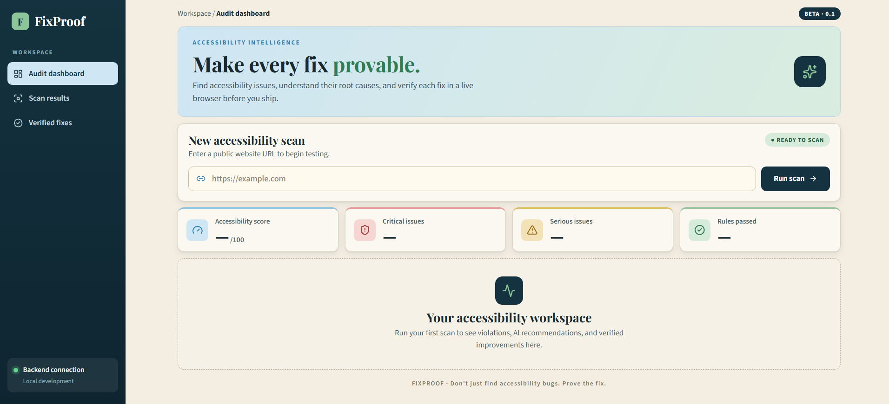
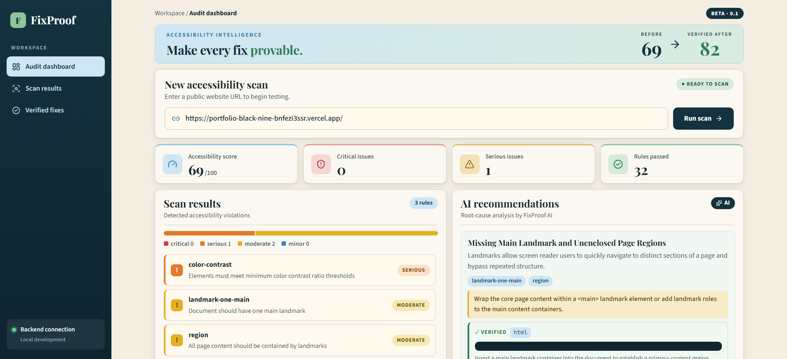
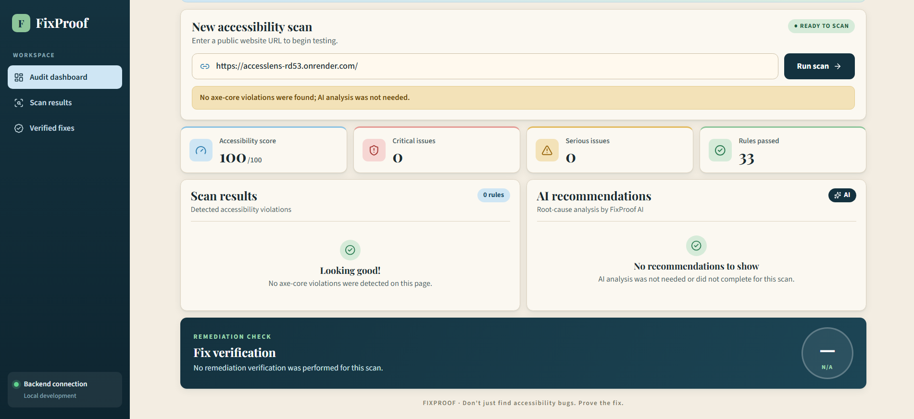
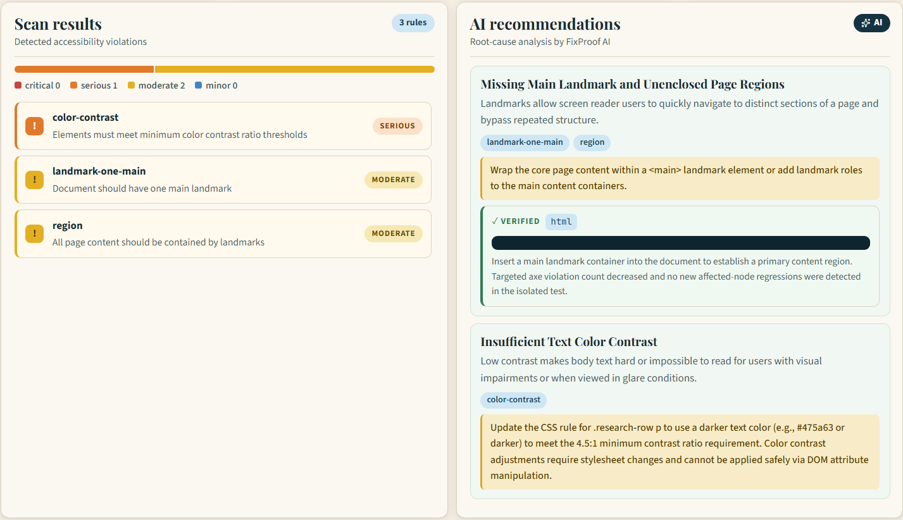

# FixProof
### Don't just find accessibility bugs. Prove the fix.

FixProof is an AI-powered web accessibility testing and remediation platform. It scans websites for accessibility issues, uses AI to explain root causes and recommend fixes, and verifies eligible fixes against axe-core in an isolated browser environment.

## Screenshots

### Dashboard


### Accessibility Scan Results


### Detailed Scan Results


### AI Recommendations


## Problem

Finding accessibility issues is only the first step. Developers often struggle to understand why an issue occurs, how to fix it safely, and whether the proposed fix actually resolves the problem.

FixProof addresses this by combining automated accessibility testing, AI-assisted explanations, and post-fix verification in one workflow.

## Key Features

- **Website Scanning:** Scan a target URL using Playwright and axe-core.
- **Accessibility Analysis:** Identify and categorize accessibility violations.
- **AI-Powered Insights:** Use Google Gemini to group related violations and explain their root causes.
- **Fix Recommendations:** Generate practical remediation suggestions.
- **Automated Verification:** Apply supported DOM-level patches in an isolated browser page and re-run accessibility checks.
- **Before-and-After Results:** Compare scan results and display verification outcomes.
- **Custom Accessibility Score:** Provide an estimated score based on detected violations.

## How It Works

```text
Website URL
    |
    v
Security Validation
    |
    v
Playwright Browser Scan
    |
    v
axe-core Accessibility Analysis
    |
    v
AI Root-Cause Analysis (Gemini)
    |
    v
Remediation Recommendations
    |
    v
Controlled DOM Patch
    |
    v
Re-run Accessibility Checks
    |
    v
Verification Results
```

## Tech Stack

| Component | Technology |
|---|---|
| Frontend | React, TypeScript, Vite |
| Styling | CSS |
| Backend | Python, FastAPI |
| Browser Automation | Playwright |
| Accessibility Engine | axe-core |
| AI Analysis | Google Gemini |
| API Communication | REST |

## Project Structure

```text
FixProof/
├── backend/
│   ├── main.py
│   ├── scanner.py
│   ├── security.py
│   ├── gemini_client.py
│   ├── verifier.py
│   ├── requirements.txt
│   └── .env.example
│
├── frontend/
│   ├── src/
│   │   ├── App.tsx
│   │   ├── App.css
│   │   └── index.css
│   ├── package.json
│   └── vite.config.ts
│
└── .gitignore
```

## Getting Started

### Prerequisites

- Python 3.10+
- Node.js and npm
- Google Gemini API key

### 1. Clone the Repository

```bash
git clone https://github.com/PeerAhammad/FixProof.git
cd FixProof
```

### 2. Set Up the Backend

```bash
cd backend
python -m venv venv
```

Activate the environment:

**Windows**
```powershell
venv\Scripts\activate
```

Install dependencies:

```bash
pip install -r requirements.txt
playwright install chromium
```

Create a `.env` file using `.env.example` and add your Gemini API key.

```env
GEMINI_API_KEY=your_api_key
GEMINI_MODEL=gemini-3.5-flash
```

Start the backend:

```bash
python run.py
```

Backend API: `http://127.0.0.1:8000`

API documentation: `http://127.0.0.1:8000/docs`

### 3. Set Up the Frontend

Open another terminal:

```bash
cd frontend
npm install
npm run dev
```

Open the local Vite URL displayed in the terminal, usually:

`http://localhost:5173`

## Important Notes and Limitations

- Automated results depend on the accessibility rules and browser state evaluated by axe-core.
- The custom accessibility score is an estimate, not an official WCAG score.
- AI-generated recommendations require developer review.
- Only supported DOM-level patches are eligible for automated verification.
- Verification indicates whether the targeted axe-core findings decreased without detected regressions in the isolated test. It does not guarantee complete WCAG compliance.
- FixProof is a development aid, not a replacement for comprehensive accessibility audits or manual assistive-technology testing.

## Security

FixProof includes URL validation and browser request controls to reduce risks when scanning external websites. Production deployments should additionally enforce network-level egress restrictions and appropriate isolation.

Never commit API keys or `.env` files to the repository.

## Vision

FixProof aims to make accessibility remediation more actionable by connecting issue detection, understandable explanations, practical fixes, and measurable verification.

**The goal isn't just to detect accessibility problems. It's to demonstrate whether a proposed fix actually helped.**

---

Built by [Peer Ahammad M. Bagawan](https://github.com/PeerAhammad)